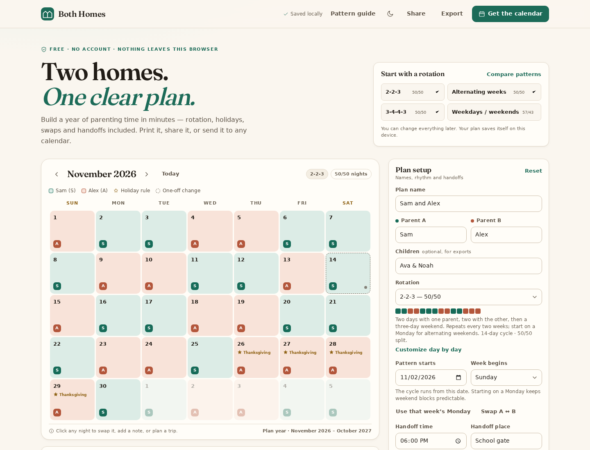
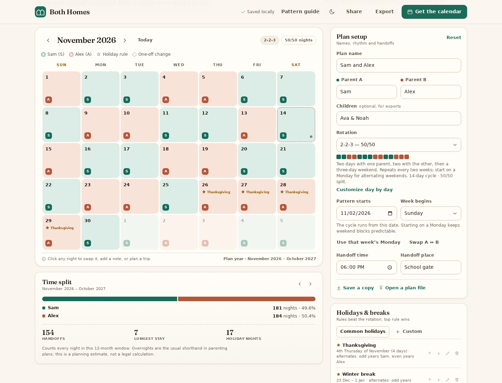
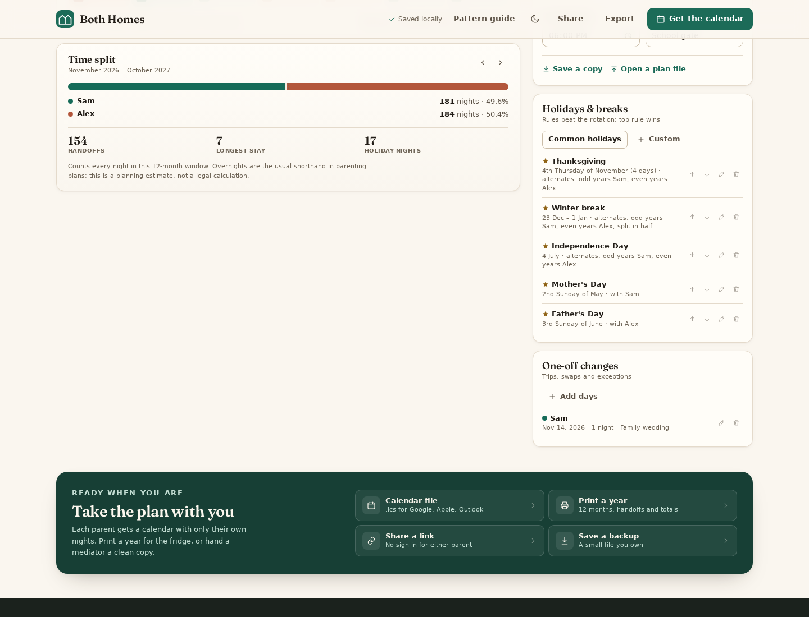
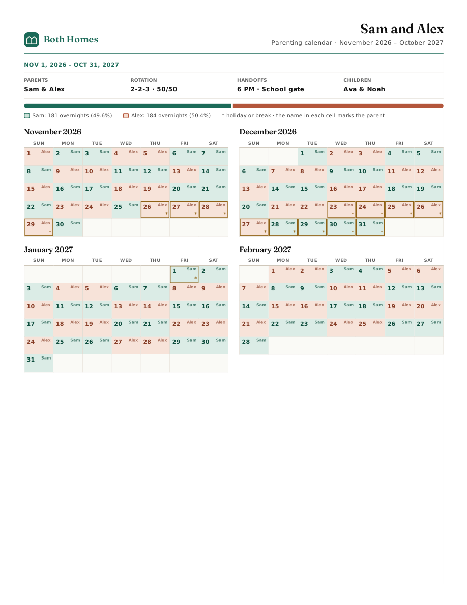
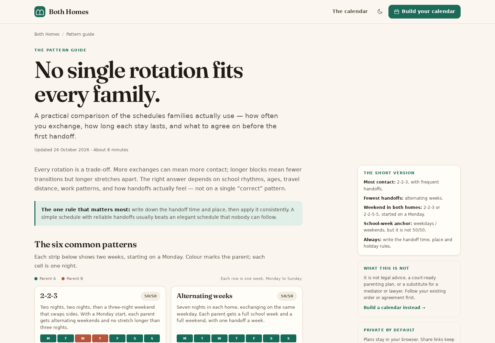
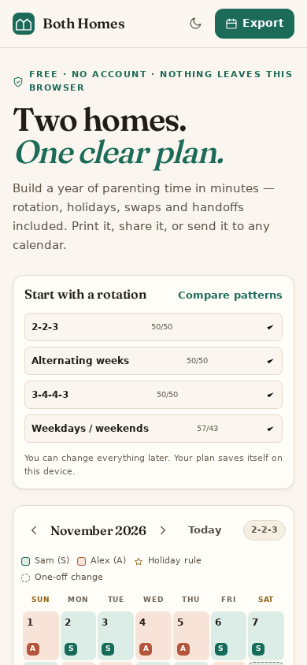

# Both Homes

### Two homes. One clear plan.

A free, local-first co-parenting calendar builder that turns a custody rotation into a real year of dates — holidays, swaps, handoffs, overnight totals, `.ics` export and a printable planner — without an account, a server, or a subscription.

Both Homes is a static site designed for GitHub Pages. The published application is the product: open it and start with a rotation.



## Why this exists

A schedule written as “2-2-3” is easy to agree on and tedious to live with. Parents still have to work out which night belongs to whom, where the holidays land, what happens when a school concert swaps a weekend, how many overnights each home actually gets, and how to get the result into a calendar that everyone can read.

The polished co-parenting platforms solve a much broader problem: messaging, records, expenses, documentation and professional access. They are priced accordingly. OurFamilyWizard listed one-year plans from **$110 to $299.88 per parent** on 26 October 2026, and each parent needs their own subscription. Custody X Change listed plans from **$6/month billed annually** for its full custody-management suite. Both are reasonable products; neither is a free, no-account, instant calendar.

Free articles and templates exist, but they stop at the article. You still rebuild the schedule by hand.

Both Homes is the **free planning layer**:

- choose a rotation (or build one);
- add holidays, breaks and one-off changes;
- see the resulting overnights and handoffs;
- print it, share it, or send each parent an `.ics` file.

It is not legal advice, a court record, a messaging platform, or an hours-based timeshare calculation. See [Known limitations](#known-limitations).

The research snapshot and source links are in [docs/RESEARCH.md](docs/RESEARCH.md). Prices are a dated comparison, not a promise about current pricing.

## What it does

### Rotations

Eight presets — 2-2-3, alternating weeks, 3-4-4-3, 4-3-3-4, 2-2-5-5, 5-2-2-5, 3-3-4-4 and weekdays/weekends — plus a custom cycle editor from 2 to 28 nights. You can swap parents, choose the start date, and use the one-click “Use that week’s Monday” alignment.

The guide is honest about weekend effects: 3-4-4-3 and 4-3-3-4 can give one parent most weekend time unless the exchange day is split. The builder does not pretend the numbers make a rotation fair.

### Holidays and exceptions

- Fixed dates, nth weekdays (for example, the fourth Thursday in November), recurring ranges, and specific dates.
- Alternate years, always Parent A/B, split a stretch in half, or alternate weeks.
- Starter sets for the **US, UK, Canada and Australia**; every item is editable, reorderable and deletable.
- The first matching holiday rule wins; an explicit night change beats every rule.
- One-off swaps and notes for trips, school events and family occasions.

### A full year, measured

The summary covers **twelve whole months** from the plan’s start month. It reports overnights and percentages, weekend nights, longest stay, handoffs, holiday nights and changed days. You can move the window forward a year without changing the rotation.

Overnights are the usual shorthand in parenting plans. They are not the same as hours: a weekend day is longer than a school day. Both Homes says so rather than presenting a legal-sounding timeshare number.

### Take it with you

- **Per-parent `.ics` files** with handoff details, or optional handoff reminders.
- **Print** a 12-month planner with key dates and exceptions. Use the browser’s “Save as PDF” for a PDF.
- **Share a link** that contains the plan in the URL. Nothing is uploaded. Names, children’s names, notes and the handoff place are left out by default; holiday labels remain.
- **Back up / restore** the complete plan as JSON.
- **Local autosave** and undo for the current session.

### Privacy and accessibility

No analytics, cookies, accounts, remote fonts or remote plan storage. The application makes no network requests after its own assets load. Plans live in `localStorage` on the device; share links are the only way the data travels, and you control who gets the link.

The interface uses semantic landmarks, labelled controls, native dialogs, visible focus states, keyboard calendar navigation, a skip link and reduced-motion handling. It has light and dark themes.

## Screenshots

The calendar and plan setup, with a sample 2-2-3 plan. Names, children and events are fictional.



The fairness summary and the holiday/exception panels.



Page 1 of the three-page print output. The last page carries key dates and exceptions.



The pattern guide answers the “which rotation?” question before handing over a prefilled builder.





## Quick start

There is no build step and no dependency install.

```bash
git clone https://github.com/<your-user>/both-homes.git
cd both-homes
npm start
# open http://localhost:4173
```

`npm start` uses Python 3’s static server. Any static server works:

```bash
python3 -m http.server 4173
```

Run the checks:

```bash
npm test       # 62 logic tests, Node's built-in test runner
npm run check  # assets, subpath safety, duplicate ids, SEO metadata and JSON-LD
```

Node 20+ is required for tests and checks. The published site needs only a modern browser.

## How the schedule is resolved

For every night in the window, the resolver applies the same priority:

1. **One-off change** — an explicit owner for that date (a trip, swap or event).
2. **Holiday/break rule** — the first rule covering the date, using its alternate-year and split settings.
3. **Base rotation** — the cycle position counted from the plan’s start date.

The result is a `day` record with `owner`, `baseOwner`, `source`, holiday details and note. The calendar, totals, `.ics` files and print layout all read from that same resolved schedule, so they cannot disagree.

A 2-2-3 that starts on a Monday gives one parent Friday-to-Sunday, then the other parent the following weekend. Start it on a Tuesday and Friday can belong to one parent while Saturday belongs to the other. The “Use that week’s Monday” button exists for that reason, and the guide explains the trade-off.

## Architecture

The site is plain HTML, CSS and ES modules. No framework, bundler, database or server runtime.

```text
index.html              Application shell
guide.html              Public pattern guide
404.html                Self-contained GitHub Pages fallback
css/
  tokens.css            Colours, type, spacing, light/dark themes
  base.css              Reset, shared components, header, footer, dialogs
  app.css               Calendar, plan, summary, export band, responsive rules
  guide.css             Editorial guide layout
  print.css             Letter print layout
js/
  app.js                Boot, state, events, persistence, share/import wiring
  guide.js              Pattern strips + shared theme preference
  core/
    dates.js            Civil-date arithmetic (no timezone drift)
    patterns.js         Rotation presets and cycle math
    holidays.js         Rule matching, occurrence ranges, splits
    schedule.js         Resolution, grouping, summaries
    ics.js              RFC 5545 calendar generation
    state.js            Validation, defaults, plan window, share projection
    storage.js          Versioned localStorage
    share.js            Base64url plan links in the URL hash
    format.js           Locale-aware display formatting
  ui/
    calendar.js         Month grid, keyboard navigation, day details
    panels.js           Quickstart, plan form, holidays, summary
    dialogs.js          Day/holiday/preset/export/share/reset dialogs
    print.js            Print DOM and key-date table
    files.js            Download/read helpers
    toast.js            Accessible toast region
  data/
    holiday-presets.js  Starter holiday rules for four regions
tests/                  Dependency-free Node tests
docs/                   Research, architecture, privacy, QA, launch
.github/workflows/      Checks and GitHub Pages deployment
scripts/
  check-assets.mjs      Missing assets, root-absolute URLs, ids, SEO metadata
  seo.mjs               Deploy-time canonical/OG URLs, sitemap.xml, robots.txt
```

The core modules have no DOM dependencies. UI modules render from a normalized plan; `app.js` owns the single mutable application state, persistence and event wiring. The design avoids a framework because the product has one screen, a handful of dialogs and no server state — a framework would add weight and a build step without removing meaningful complexity.

More detail: [docs/ARCHITECTURE.md](docs/ARCHITECTURE.md).

## Data model

A plan is one JSON object, versioned and validated on every entry point:

```json
{
  "version": 1,
  "planName": "Sam and Alex",
  "parents": { "a": { "name": "Sam" }, "b": { "name": "Alex" } },
  "children": "Ava & Noah",
  "pattern": {
    "id": "223",
    "cycle": ["a","a","b","b","a","a","a","b","b","a","a","a","b","b"]
  },
  "startDate": "2026-11-02",
  "weekStart": "sun",
  "handoff": { "time": "18:00", "place": "School gate" },
  "windowOffset": 0,
  "holidays": [],
  "overrides": {
    "2026-11-14": { "owner": "a", "note": "Family wedding" }
  }
}
```

The pattern `cycle` is one owner per night and repeats from `startDate`; the `id` lets the UI recover a preset if the stored cycle is missing. Holiday rules are validated individually and dropped if malformed rather than breaking the whole plan. Overrides are capped, date-checked and note-sanitized. `normalizePlan` is the single validation boundary for imports, share links and storage.

## Privacy

The short version: **the app has no backend to send your plan to.**

- Plans and the theme preference are stored in `localStorage`.
- Share links put a base64url-encoded snapshot in the URL **hash**; the fragment is not sent to the web server in an HTTP request.
- Names, children, notes and handoff place are excluded from share links unless the user explicitly includes them. Holiday labels remain so the calendar still makes sense.
- Exports are files you download. Nothing is uploaded to create them.
- The deployed site is served by GitHub Pages; the application calls no other service.

GitHub, like any host, sees ordinary HTTP requests for the site and its assets. The application does not add analytics or tracking. A host-level access log is outside the app’s control.

Full data-handling notes: [docs/PRIVACY.md](docs/PRIVACY.md).

## Market positioning

| Alternative | What it is good at | Why Both Homes is different |
| --- | --- | --- |
| OurFamilyWizard | Communication, records, expenses, professional access | Both Homes is free, local-first and only the planning layer. It is not a records platform. |
| Custody X Change | Full custody management, written plans, calculations | Both Homes is a no-account static utility; it does not generate legal documents or track expenses. |
| Generic calendars | Familiar sync and notifications | No rotation engine, holiday precedence, overnight fairness math or printable key-date summary. |
| Spreadsheets/templates | Flexible, private, free | Manual and fragile; no `.ics`, link sharing or responsive calendar. |

The guide is part of the product strategy: it addresses the search a parent makes before they need the tool, then links to a prefilled builder. It is a static page, not a thin keyword farm.

## Deploy to GitHub Pages

The repository includes `.github/workflows/pages.yml`. It runs the tests and asset check, copies only the public site files into `_site`, and deploys with the official Pages actions.

1. Push the repository to GitHub. The workflow triggers on `main`; change the branch in `.github/workflows/pages.yml` if your default branch is `master`.
2. In the repository, open **Settings → Pages**.
3. Under **Build and deployment**, set **Source** to **GitHub Actions**.
4. Push to `main` (or run the workflow manually from **Actions → Deploy to GitHub Pages**).
5. The site appears at `https://<user>.github.io/<repository>/`.

There are no secrets, API keys, database bindings or build artifacts to configure. The deployment job only needs the repository’s default `GITHUB_TOKEN` permissions declared in the workflow.

### Search and social previews

Both pages ship a complete metadata set: a unique title, a description written for a search result, `robots` with `max-image-preview:large`, a self-canonical, Open Graph and Twitter card tags with a 1200×630 image, and `application/ld+json` structured data (`WebSite` + `WebApplication` on the calendar, `Article` + `BreadcrumbList` on the guide). No ratings, review counts or user statistics are declared, because none exist.

After `actions/configure-pages` reports the site URL, the workflow runs:

```bash
node scripts/seo.mjs --dir _site --base https://<user>.github.io/<repository>/
```

That step rewrites the canonical, `og:url`, `og:image` and `twitter:image` to absolute URLs for the real deployment (resolving inside JSON-LD too), then writes `sitemap.xml` listing both pages and a `robots.txt` that points at the sitemap. Nothing is hard-coded to a specific account, so a fork or a custom domain works without editing the HTML.

To preview the generated output locally:

```bash
npm run seo   # writes canonical/OG/sitemap into ./_site
```

After the first deploy, submit `https://<user>.github.io/<repository>/sitemap.xml` in Google Search Console and Bing Webmaster Tools. Indexing is not guaranteed and no ranking is claimed; the guide page is the entry point for the queries a parent searches before they need a calendar.

### Repository subpaths

Every local asset and page link is relative (`./assets/...`, `./css/...`, `./index.html`). The app works at a domain root or under a repository path. The deployment check (`npm run check`) rejects root-absolute asset URLs and verifies that every referenced file and ES module exists.

The share-link base is taken from the current URL, so links keep working under a subpath. The source pages use **relative** canonical and Open Graph URLs, so they are correct on any host, at a domain root or under a repository path — no hard-coded domain to edit when you fork.

The canonical URL is deliberately relative: `./` on the calendar and `./guide.html` on the guide. A relative canonical resolves to the page's own absolute URL wherever it is hosted, so it is always a valid self-canonical. On deploy, `scripts/seo.mjs` resolves these against the real Pages URL, because social scrapers and sitemaps require absolute URLs.

`404.html` is a self-contained fallback, so a missing path still renders without relying on the repository subpath.

### Local production check

```bash
mkdir -p _site
cp -R index.html guide.html 404.html .nojekyll assets css js _site/
python3 -m http.server 4173 --directory _site
```

To test a subpath locally, put `_site` inside a parent directory as `both-homes/`, serve the parent, and open `http://localhost:4173/both-homes/`.

## Testing and quality

`npm test` runs **62** dependency-free tests covering:

- civil-date arithmetic, month grids, leap years and ISO validation;
- all rotation presets, custom cycles, cycle labels and resize/swap behavior;
- holiday occurrence rules, nth weekdays, alternate years, splits, priority and validation;
- schedule resolution precedence, contiguous block grouping, summaries and overrides;
- `.ics` escaping, line folding, UTC stamps and event generation;
- plan normalization, storage versions, share projections and URL links;
- locale normalization (including a browser’s `en-US@posix` tag).

`npm run check` validates 100 local references across the three HTML pages, CSS and ES modules, rejects root-absolute URLs and duplicate IDs, and asserts that both indexable pages carry a canonical link, the social-card meta tags, a robots directive and parseable JSON-LD. It also warns when a title or description falls outside a sensible search-result length.

Browser qualification was performed with Playwright and Chromium at desktop and phone widths: the calendar, plan form, holidays, swaps, custom cycle, exports, share links, theme, backup/reset/restore, print, keyboard dialogs and mobile layout. The exact checks and the limitations (no Safari/Firefox, no real screen reader or automated axe audit, no live calendar-app import) are recorded in [docs/QA.md](docs/QA.md).

## Known limitations

- **Not legal advice or a court record.** Follow the existing order or agreement. The app does not produce a parenting plan, serve documents, or keep an audit trail.
- **Overnights, not hours.** A 50/50 overnight split is not necessarily a 50/50 hours split; school time and third-party care are not modelled.
- **One planning year at a time.** The summary and print cover 12 whole months; move the window forward for the next year. There is no multi-year timeline.
- **Local-only by default.** Clearing site data removes the plan. Export a JSON backup. There is no account, sync or multi-device merge.
- **Share links are snapshots.** Editing the plan afterward does not update a link that was already sent. Anyone with the link can read what it contains. Holiday labels are retained even when names are off.
- **Holiday coverage is intentionally conservative.** Easter is not computed, and school calendars vary by district. Add local dates and breaks manually.
- **Calendar exports use floating local times.** Each calendar app applies its own timezone. Re-importing a new file can create duplicate events; remove the old calendar first.
- **Printing is three Letter pages** at the current legible cell size. Use the browser’s print dialog for paper size, margins or PDF.
- **Browser support** targets current Chromium, Firefox and Safari (ES modules, `<dialog>`, `:has()` with graceful fallback). Qualification in this environment used Chromium only; see QA.
- **No automated accessibility audit was run.** Keyboard, labels, dialog behavior, focus and overflow were checked manually and with browser automation. A screen-reader pass is still needed.
- **No hosted demo is claimed.** This repository is the deliverable; publish it with the workflow above.

## Roadmap

- Easter/computus support and more regional holiday packs.
- Optional hour-based timeshare estimates with explicit assumptions.
- Multi-year view and a school-year planning mode.
- A reproducible Playwright suite committed to the repository.
- More locales and translated guide pages.
- A real screen-reader and automated accessibility pass.

Optional paid capabilities (for example, encrypted cross-device sync) would require a backend and are deliberately not promised here. The free local core should remain useful without them.

## Contributing

See [CONTRIBUTING.md](CONTRIBUTING.md). In short: keep it static and dependency-free, use relative paths, validate untrusted plans, add tests for core logic, and run `npm test && npm run check`.

## License

MIT — see [LICENSE](LICENSE). The license covers the code and documentation. No trademark clearance is claimed for the name or logo.

---

**Both Homes is a planning tool, not legal advice.** If you are resolving a custody dispute, work with a qualified professional and follow your existing court order or parenting agreement.
